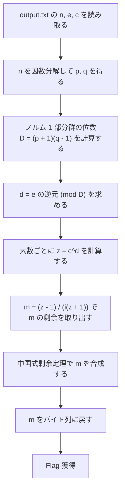

> [!IMPORTANT]
> **Solved with Codex and Claude Code**
>
> この問題は AI コーディングアシスタント **Codex** と **Claude Code** を活用して解決されました。

> [!NOTE]
> この Writeup は AI により自動生成されています。 本ドキュメントは、AI アシスタントを用いて作成された Writeup です。記載内容は解法の一例であり、内容の正確性については十分にご確認の上ご利用ください。

# RSAngle

## 概要
*   **カテゴリー**: Crypto
*   **トピック**: RSA
*   **難易度**: Very Hard
*   **問題リンク**: [RSAngle - Daily AlpacaHack](https://alpacahack.com/daily-bside/challenges/rsangle)

## 使用ツール
本問題を解くにあたって使用したツールは次の通りです。

*   **Python 3.8 以降**: 解法スクリプトの実装と、剰余環での演算
*   **PARI/GP**: 法 `n` の因数分解
*   **Codex**: 配布ファイルの解析およびコード生成
*   **Claude Code**: 解法の独立した検証

## 問題の分析
本問題は、**Daily AlpacaHack** の B-SIDE 問題です。問題文は次の通りです。

> RSA, but angled.

この問題はサーバーに接続する形式ではなく、配布ファイルとプログラムの実行結果からフラグを復元する形式です。配布ファイルは次の通りです。

| ファイル | 内容 |
| :--- | :--- |
| `chall.sage` | 問題プログラムのソースコード（SageMath） |
| `output.txt` | プログラムの実行結果（`n`、`e`、`c` の値） |

プログラムの動作は次の通りです。96 ビットの素数 `p`、`q` を選び、`n = p * q`、`e = 65537` とします。フラグを整数 `m` として読み取り、剰余環 `C = (Z/nZ)[x] / (x^2 + 1)` の中で `z` と `c` を計算し、`n`、`e`、`c` を公開します。

```python
z = (1 + i*m) / (1 - i*m)
c = z^e
```

ここで `i` は `i^2 = -1` を満たす元で、環の元は `a + b*i` の形をしています。公開される `c` は、係数の組 `(c0, c1)` として `c0 + c1*i` の形で与えられます。

ポイントは次の 3 つです。

1. `n` は 192 ビットしかなく、既存の道具で因数分解できます。
2. `z` はノルムが 1 の元で、ノルム 1 の元全体は部分群をなします。その位数は `n` の素因数から決まります。
3. `e` と部分群の位数が互いに素なため、部分群の中では `e` 乗を逆算して `z` を復元できます。`z` からは式変形で `m` が取り出せます。

## 脆弱性の詳細

### 剰余環とノルム
環 `C` の元 `a + b*i` に対して、ノルムを `N(a + b*i) = a^2 + b^2` と定義します。ノルムには、積について `N(x * y) = N(x) * N(y)` が成り立つという性質があります。

この性質を使うと、`z` のノルムは次のように計算できます。

```math
N(z) = \frac{N(1 + im)}{N(1 - im)} = \frac{1 + m^2}{1 + m^2} = 1
```

したがって `z` はノルム 1 の元であり、その冪である `c = z^e` もノルム 1 の元です。ノルム 1 の元全体は積と逆元で閉じているため、部分群をなします。以後の計算はすべてこの部分群の中で行えます。

なお、この計算で割り算ができるのは、分母 `1 - i*m` が逆元を持つ場合に限ります。逆元を持つのはノルムが `n` と互いに素な元だけで、`1 - i*m` のノルムは `1 + m^2` であるため、`z` が定義できるのは `gcd(1 + m^2, n) = 1` の場合です。この問題では暗号文が生成できているため、この条件が満たされています。

### ノルム 1 部分群の位数
法が素数 `r` の場合、剰余環の構造は `x^2 + 1` が `mod r` で既約かどうかで変わります。

| 条件 | 剰余環の構造 | ノルム 1 部分群の位数 |
| :--- | :--- | :--- |
| `r ≡ 3 (mod 4)` | `x^2 + 1` は既約で、商は `F_{r^2}`（`r^2` 個の元を持つ体） | `r + 1` |
| `r ≡ 1 (mod 4)` | `x^2 + 1` は分解し、商は `F_r × F_r` と同型 | `r - 1` |

この問題の素因数は、小さい方が `≡ 3 (mod 4)`、大きい方が `≡ 1 (mod 4)` でした。中国式剰余定理により、`mod n` でのノルム 1 部分群の位数は、素数ごとの位数の積になります。

```math
D = (p + 1)(q - 1)
```

### 指数の逆算
`e = 65537` と `D` は互いに素だったため、`d = e^(-1) mod D` が存在します。ノルム 1 部分群の中では元の位数が `D` を割り切るので、`c` を `d` 乗すると `e` 乗の効果が打ち消されます。

```math
c^d = (z^e)^d = z
```

つまり、因数分解で `D` が分かれば、暗号化と同じ形の冪乗を 1 回行うだけで `z` が復元できます。

### `z` から `m` を取り出す
`z = (1 + i*m) / (1 - i*m)` の両辺に `1 - i*m` を掛けて `m` について解くと、次の形になります。

```math
m = \frac{z - 1}{i(z + 1)}
```

この計算を素数 `p`、`q` ごとに行って `m mod p` と `m mod q` を求め、中国式剰余定理で合成すると `m mod n` が得られます。問題プログラムは暗号化の前に `m < n` を assert しているため、この値がそのまま元の `m` になります。`m` をバイト列に戻したものがフラグです。

## 攻撃フロー


## 補足

<details>
<summary>補足: 問題名 rsangle の由来（クリックで展開）</summary>

`m = tan θ` と置くと、`z = (1 + i*m) / (1 - i*m)` は単位円上の点 `e^(2iθ)` に対応します。分母と分子に `cos θ` を掛けると `(cos θ + i*sin θ) / (cos θ - i*sin θ)` となり、これは角度 `θ` の回転とその逆回転の比だからです。つまり `z` は「角度」を符号化した元で、`z` の `e` 乗は角度を `e` 倍することに対応します。RSA と angle を組み合わせた名前は、この構造を表しています。なお、これは複素数としての幾何学的な解釈であり、剰余環の中で実数の角度そのものを扱っているわけではありません。

</details>

<details>
<summary>補足: gcd(e, D) = 1 が必要な理由（クリックで展開）</summary>

部分群の中で `e` 乗する操作が元に戻せるのは、`e` と部分群の位数 `D` が互いに素な場合に限ります。共通因数があると `e` 乗は全単射にならず、`c` から復元できる `z` の候補が複数に分かれてしまいます。この問題では互いに素だったため、`z` は一意に復元できました。

</details>

<details>
<summary>補足: 192 ビットの法の因数分解（クリックで展開）</summary>

この問題の法は `p`、`q` が各 96 ビットで、積は 192 ビットです。この大きさの合成数の因数分解は、PARI/GP や SageMath のような既存の道具で短時間に終わります。実際の RSA で使われる法（2048 ビット級）とは桁が違います。

</details>

> [!WARNING]
> この問題の本質は、**法 `n` が 192 ビットしかなく、因数分解できてしまう**点にあります。因数分解できればノルム 1 部分群の位数 `D` が分かり、`e` の逆元まで計算できるため、`c` から `z`、`m` へと順に逆算できてしまいます。通常の RSA でも、法の因数分解は秘密鍵の計算につながる致命的な弱点です。

## 用語解説
*   **剰余環 `(Z/nZ)[i]`**: 整数を `n` で割った余りの環に、`i^2 = -1` を満たす元 `i` を追加した環です。元は `a + b*i` の形で表されます。
*   **ノルム**: 元 `a + b*i` に対して `a^2 + b^2` を対応させる関数です。積について `N(x * y) = N(x) * N(y)` が成り立ちます。
*   **ノルム 1 部分群**: ノルムが 1 の元全体の集合です。積と逆元で閉じているため、群をなします。
*   **既約**: 多項式が、考えている係数の範囲ではそれ以上因数分解できないことです。`x^2 + 1` が `mod r` で既約かどうかは、奇素数 `r` については `r mod 4` の値で決まります。
*   **中国式剰余定理（CRT）**: 互いに素な法に対する剰余の組から、それらの積を法とする剰余を一意に復元する定理です。

## 解決スクリプト
[solve.py を参照してください](./solve.py)

```bash
python3 solve.py
```

スクリプトには `output.txt` で公開された `n`、`e`、`c` の値が含まれており、実行するとフラグを復元して表示します。因数分解は、`gp` コマンドがあれば PARI/GP で、なければ Python バインディングの cypari2 で行います。どちらもない環境では、SageMath の `sage` コマンドで因数分解します。いずれも入っていない環境ではスクリプトは案内を表示して終了するため、実行前に `pari-gp` をインストールするか、`pip install cypari2` で cypari2 を導入するか、SageMath をインストールしておくことを推奨します。なお、cypari2 の現在のバージョン（2.2.4）は Python 3.12 以降を必要とします。それより古い Python では古いバージョンが選ばれ、環境によってはソースからのビルドが必要になります。
